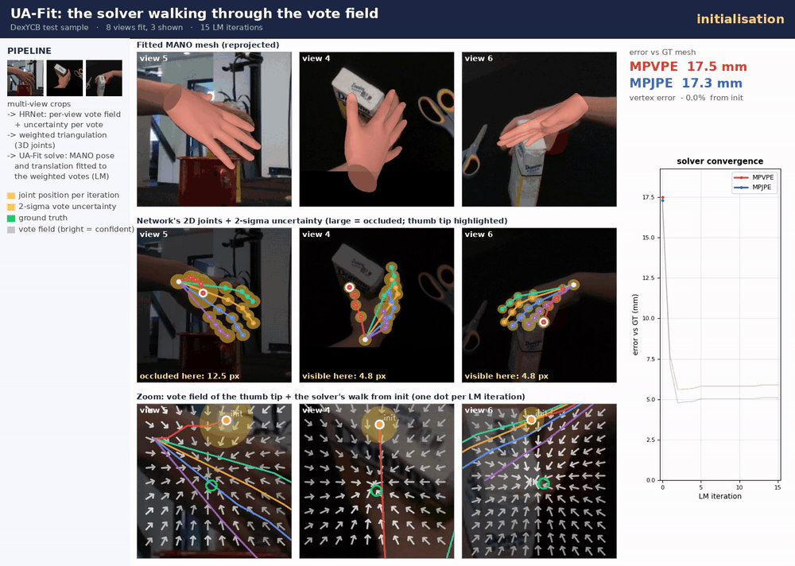
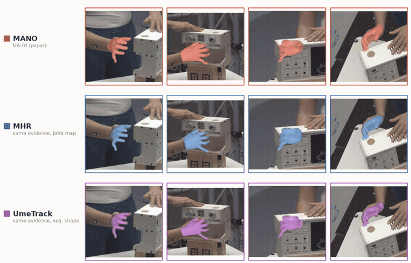

# UA-Fit (code)

**Learn 2D, Solve 3D: UA-Fit, an Uncertainty-Weighted Analytical Solver for
Multi-view Hand Mesh Recovery.** ECCV 2026 &mdash; HANDS Workshop.

Marsil Zakour, Constantin Patsch, Martin Piccolrovazzi, Yuankai Wu, Eckehard
Steinbach &middot; Technical University of Munich (Chair of Media Technology, MIRMI).

**[Project page](https://marsilzakour.github.io/ua-fit/)** &middot;
[Paper (PDF)](https://marsilzakour.github.io/ua-fit/paper/uafit_hands2026.pdf) &middot;
[Model weights](https://huggingface.co/Marsil123/ua-fit) &middot;
[Solver core (parafit)](https://github.com/MarsilZakour/parafit)

UA-Fit learns only per-view 2D evidence (a dense oriented vote field with
per-vote anisotropic precision); a parameter-free analytical Levenberg&ndash;Marquardt
solver lifts it to a MANO-consistent 3D hand. The reconstruction stage is only
2.0M parameters, and the analytic kinematic Jacobian makes each solve about
14&times; cheaper than automatic differentiation.

<p align="center">
  
  <br>
  <em>UA-Fit on a DexYCB test sample: the network's per-view 2D joints come with an uncertainty (large where the
  thumb is hidden behind the object, small where it is visible); the solver walks each joint through the vote field
  to the ground truth (bottom, zoomed) while the fitted MANO mesh converges (top) in a few LM iterations.</em>
</p>

This repository reproduces **Table 1** of the paper: multi-view parametric hand
mesh recovery on five benchmarks. The reusable, model-agnostic solver core is
released separately as
**[parafit](https://github.com/MarsilZakour/parafit)**.

## Install

```bash
# torch for your platform first: https://pytorch.org/get-started/locally/
pip install -r requirements.txt          # includes parafit (the solver) and manotorch (MANO layer)
```

MANO model files are license-restricted and not shipped here. Download
`MANO_RIGHT.pkl` (and `MANO_LEFT.pkl`) from https://mano.is.tue.mpg.de/ and place
them under `assets/mano_v1_2/models/`.

## Checkpoint and data

- **Checkpoint**: [Marsil123/ua-fit](https://huggingface.co/Marsil123/ua-fit) on Hugging Face
  (`uafit_w40.safetensors`). The code downloads and caches it on first use; for offline use see
  [checkpoints/README.md](checkpoints/README.md).
- **Datasets**: the multi-view test splits as WebDataset shards under `data/dataset_tars/`
  (shard patterns, view counts and split sizes: `uafit/data/loader.py::TEST_SPLITS`):

```
data/dataset_tars/
  DexYCB_mv/DexYCB_mv_test-{000000..000003}.tar
  HO3D_mv_test/HO3D_mv_test-{000000..000002}.tar
  Arctic_mv/Arctic_mv_val_p1-{000000..000045}.tar
  Interhand_mv/Interhand_mv_val-{000000..000022}.tar
  Oakink_mv/Oakink_mv_test-{000000..000045}.tar
```

  Each shard sample is one multi-view frame: `image_<v>.jpg` per camera plus `label.pyd` (a pickle with per-camera
  `cam_intr`, `cam_extr`, `bbox_center`, `bbox_scale` and the ground truth `joints_3d`, `verts_3d`, `mano_pose`,
  `mano_shape`).

## Reproduce Table 1

```bash
python scripts/evaluate.py
```

Evaluates the full official split of every dataset at its fixed view count and
prints MPVPE / MPJPE / PA-MPVPE (mm) next to the paper's numbers:

| dataset (views) | MPVPE | MPJPE | PA-MPVPE |
|---|---|---|---|
| DexYCB (8v)    | 7.86 | 7.55 | 4.92 |
| HO3D (5v)      | 8.01 | 7.41 | 5.10 |
| ARCTIC (8v)    | 7.54 | 6.62 | 5.66 |
| InterHand (8v) | 8.77 | 7.79 | 6.23 |
| OakInk (4v)    | 9.58 | 8.86 | 5.67 |

See [REPRODUCE.md](REPRODUCE.md) for the protocol, per-dataset and subset
commands, and how the refactored code was checked against the original.

## Examples

### Evaluate on the WebDataset shards

```bash
python scripts/evaluate.py --checkpoint Marsil123/ua-fit --datasets HO3D          # one dataset, full split
python scripts/evaluate.py --datasets HO3D DexYCB --limit 200                      # quick subset
python scripts/evaluate.py --datasets DexYCB --views 4                             # fewer cameras
python scripts/evaluate.py --data-root /path/to/dataset_tars --output results.json
```

### Run UA-Fit from Python

Shards -> network (weights from Hugging Face) -> uncertainty-weighted MANO fit:

```python
import torch
from uafit.data import batch_to_device, build_test_loader
from uafit.fitting import fit_hands
from uafit.hand_models import build_hand
from uafit.network import load_uafit_network

device = "cuda"
network = load_uafit_network("Marsil123/ua-fit", device=device)   # downloads uafit_w40.safetensors
mano = build_hand("mano", device=device)

loader = build_test_loader("HO3D", "data/dataset_tars", batch_size=4, workers=0)
batch = batch_to_device(next(iter(loader)), device)                # images + cameras of all views per scene

with torch.no_grad():
    evidence = network(batch)                                      # vote fields, uncertainty, triangulated joints, shape
    fit = fit_hands(mano, evidence, network.huber_radius_px)       # uncertainty-weighted LM solve

fit.joints          # (B, 21, 3) joints in metres (OpenPose order)
fit.mano_vertices   # (B, 778, 3) MANO vertices in metres
fit.params          # (B, 51) MANO axis-angle pose (48) + translation (3); shape = evidence.mano_betas
```

For your own cameras, build a batch with the same keys (`image`, `target_cam_intr`, `target_cam_extr`,
`cam_view_num`; see `uafit/data/collate.py`).

### Read a shard directly

```python
import webdataset as wds

shard = "data/dataset_tars/HO3D_mv_test/HO3D_mv_test-000000.tar"
for sample in wds.WebDataset(shard, shardshuffle=False).decode("rgb8"):
    views = sorted(k for k in sample if k.startswith("image_"))
    label = sample["label.pyd"]
    print(len(views), "cameras", sample[views[0]].shape, label["cam_intr"][0].shape, label["verts_3d"][0].shape)
    break
```

### Optional: fit other hand models

The solver is model-agnostic ([parafit](https://github.com/MarsilZakour/parafit)), so the same network output can also
be fitted with Meta's MHR hand or the UmeTrack hand (MANO's joints mapped onto them through a calibrated
correspondence; assets: [assets/README.md](assets/README.md)). These are examples, not part of the paper:

<p align="center">
  
  <br>
  <em>One network output per frame, three hand models: MANO (UA-Fit), MHR and UmeTrack fitted by the same solver
  (ARCTIC test sequence, 4 of 8 views; UmeTrack with one shape fitted per sequence).</em>
</p>

```bash
python scripts/evaluate.py --datasets HO3D --limit 200 --hand-model mhr
python scripts/evaluate.py --datasets HO3D --limit 200 --hand-model umetrack
```

## Code layout

```
uafit/network/       images of all views -> vote field, vote precision, triangulated joints, MANO shape
uafit/data/          test-split WebDataset loader (view selection, crops, InterHand re-crop)
uafit/fitting.py     the UA-Fit objective as parafit energies + LM solve
uafit/hand_models.py the fitted hand model (MANO; MHR / UmeTrack examples)
uafit/metrics.py     MPVPE, mesh-regressed MPJPE, PA-MPVPE
scripts/evaluate.py  Table 1
```

## Training

The training code and full from-scratch recipe are released after the paper is
published. This repository currently provides evaluation / inference and the
released checkpoint.

## Citation

```bibtex
@inproceedings{zakour2026uafit,
  title     = {Learn 2D, Solve 3D: UA-Fit, an Uncertainty-Weighted Analytical
               Solver for Multi-view Hand Mesh Recovery},
  author    = {Zakour, Marsil and Patsch, Constantin and Piccolrovazzi, Martin
               and Wu, Yuankai and Steinbach, Eckehard},
  booktitle = {European Conference on Computer Vision (ECCV) Workshops --- HANDS},
  year      = {2026}
}
```
