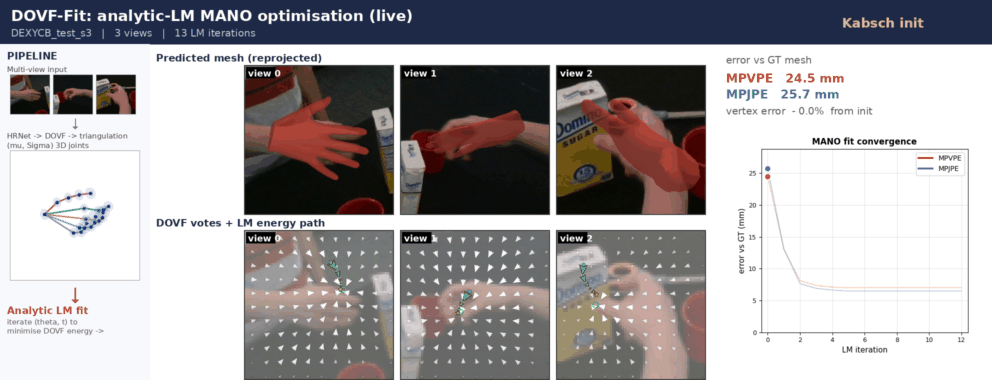

# UA-Fit (code)

**Learn 2D, Solve 3D: UA-Fit, an Uncertainty-Weighted Analytical Solver for
Multi-view Hand Mesh Recovery.** ECCV 2026 &mdash; HANDS Workshop.

Marsil Zakour, Constantin Patsch, Martin Piccolrovazzi, Yuankai Wu, Eckehard
Steinbach &middot; Technical University of Munich (Chair of Media Technology, MIRMI).

**[Project page](https://marsilzakour.github.io/ua-fit/)** &middot;
[Solver core (parafit)](https://github.com/MarsilZakour/parafit) &middot; Paper (coming soon)

UA-Fit learns only per-view 2D evidence (a dense oriented vote field with
per-vote anisotropic precision); a parameter-free analytical Levenberg&ndash;Marquardt
solver lifts it to a MANO-consistent 3D hand. The reconstruction stage is only
2.0M parameters, and the analytic kinematic Jacobian makes each solve about
14&times; cheaper than automatic differentiation.

<p align="center">
  
  <br>
  <em>The analytical solver converging on a DexYCB sample: fitted MANO hand and energy, live over LM iterations.</em>
</p>

This repository reproduces **Table 1** of the paper: multi-view parametric hand
mesh recovery on five benchmarks. The reusable, model-agnostic solver core is
released separately as
**[parafit](https://github.com/MarsilZakour/parafit)**.

## Install

```bash
# torch for your platform first: https://pytorch.org/get-started/locally/
pip install -r requirements.txt          # includes parafit (the solver) and manotorch (MANO layer)
```

MANO model files are license-restricted and not shipped here. Download
`MANO_RIGHT.pkl` (and `MANO_LEFT.pkl`) from https://mano.is.tue.mpg.de/ and place
them under `assets/mano_v1_2/models/`. MHR and UmeTrack assets are only needed
for the alternative hand models, see [assets/README.md](assets/README.md).

## Data and checkpoint

- **Checkpoint**: downloaded automatically from Hugging Face
  ([Marsil123/ua-fit](https://huggingface.co/Marsil123/ua-fit)) with `--checkpoint Marsil123/ua-fit`;
  for offline use see [checkpoints/README.md](checkpoints/README.md).
- **Datasets**: multi-view WebDataset shards of DexYCB, HO3D, ARCTIC,
  InterHand2.6M and OakInk under `data/dataset_tars/` (shard patterns and
  split sizes: `uafit/data/loader.py::TEST_SPLITS`).

## Reproduce Table 1

```bash
python scripts/evaluate.py --checkpoint Marsil123/ua-fit
```

Evaluates the full official split of every dataset at its fixed view count and
prints MPVPE / MPJPE / PA-MPVPE (mm) next to the paper's numbers:

| dataset (views) | MPVPE | MPJPE | PA-MPVPE |
|---|---|---|---|
| DexYCB (8v)    | 7.86 | 7.55 | 4.92 |
| HO3D (5v)      | 8.01 | 7.41 | 5.10 |
| ARCTIC (8v)    | 7.54 | 6.62 | 5.66 |
| InterHand (8v) | 8.77 | 7.79 | 6.23 |
| OakInk (4v)    | 9.58 | 8.86 | 5.67 |

See [REPRODUCE.md](REPRODUCE.md) for the protocol, per-dataset and subset
commands, and how the refactored code was checked against the original.

## Other hand models: MHR and UmeTrack

The network predicts MANO-convention evidence, but the solver is model-agnostic
([parafit](https://github.com/MarsilZakour/parafit)). The same checkpoint can
fit Meta's MHR hand or the UmeTrack hand instead of MANO:

```bash
python scripts/evaluate.py --checkpoint Marsil123/ua-fit --hand-model mhr
python scripts/evaluate.py --checkpoint Marsil123/ua-fit --hand-model umetrack
```

MANO's 21 joints (16 mesh-regressed joints + 5 fingertips) are not the skeleton
joints of these models, so each MANO joint is attached to one bone of the target
hand with a fixed offset. The correspondence is calibrated once on synthetic
MANO hands (`scripts/build_mano_correspondence.py`, shipped in
`assets/correspondences/`); the hand size follows the predicted MANO shape as a
uniform scale. Metrics stay comparable to MANO ground truth: joints are the
fitted model's MANO-convention joints and vertices are MANO-topology points read
off the fitted mesh. Results: [REPRODUCE.md](REPRODUCE.md#other-hand-models).

## Use in your code

The weights are downloaded from Hugging Face ([Marsil123/ua-fit](https://huggingface.co/Marsil123/ua-fit)) on first
use and cached. One multi-view batch -> fitted hands:

```python
import torch
from uafit.data import batch_to_device, build_test_loader
from uafit.fitting import fit_hands
from uafit.hand_models import build_hand
from uafit.network import load_uafit_network

device = "cuda"
network = load_uafit_network("Marsil123/ua-fit", device=device)   # downloads uafit_w40.safetensors
hand = build_hand("mano", device=device)                           # or "mhr" / "umetrack" (see assets/README.md)

loader = build_test_loader("HO3D", "data/dataset_tars", batch_size=4, workers=0)
batch = batch_to_device(next(iter(loader)), device)                # images + cameras of all views per scene

with torch.no_grad():
    evidence = network(batch)                                      # vote fields, uncertainty, triangulated joints, shape
    fit = fit_hands(hand, evidence, network.huber_radius_px)       # uncertainty-weighted LM solve

fit.joints          # (B, 21, 3) joints in metres (MANO convention, OpenPose order)
fit.mano_vertices   # (B, 778, 3) MANO-topology vertices in metres
fit.params          # (B, P) the hand model's parameters
```

For your own data, build a batch with the same keys (`image`, `target_cam_intr`, `target_cam_extr`,
`cam_view_num`; see `uafit/data/collate.py`).

## Code layout

```
uafit/network/       images of all views -> vote field, vote precision, triangulated joints, MANO shape
uafit/data/          test-split WebDataset loader (view selection, crops, InterHand re-crop)
uafit/fitting.py     the UA-Fit objective as parafit energies + LM solve
uafit/hand_models.py MANO / MHR / UmeTrack behind one interface (MANO-convention landmarks)
uafit/metrics.py     MPVPE, mesh-regressed MPJPE, PA-MPVPE
scripts/evaluate.py  Table 1 (and --hand-model mhr|umetrack)
scripts/build_mano_correspondence.py   calibrate MANO joints on MHR / UmeTrack
```

## Training

The training code and full from-scratch recipe are released after the paper is
published. This repository currently provides evaluation / inference and the
released checkpoint.

## Citation

```bibtex
@inproceedings{zakour2026uafit,
  title     = {Learn 2D, Solve 3D: UA-Fit, an Uncertainty-Weighted Analytical
               Solver for Multi-view Hand Mesh Recovery},
  author    = {Zakour, Marsil and Patsch, Constantin and Piccolrovazzi, Martin
               and Wu, Yuankai and Steinbach, Eckehard},
  booktitle = {European Conference on Computer Vision (ECCV) Workshops --- HANDS},
  year      = {2026}
}
```
